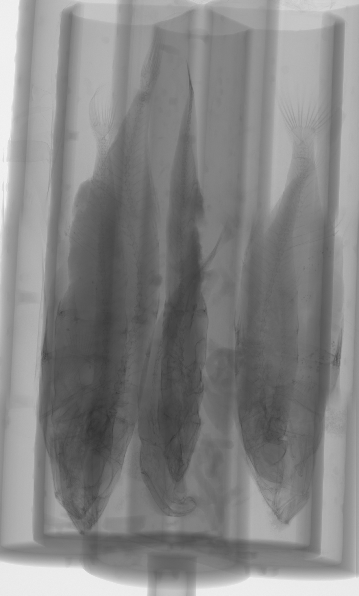
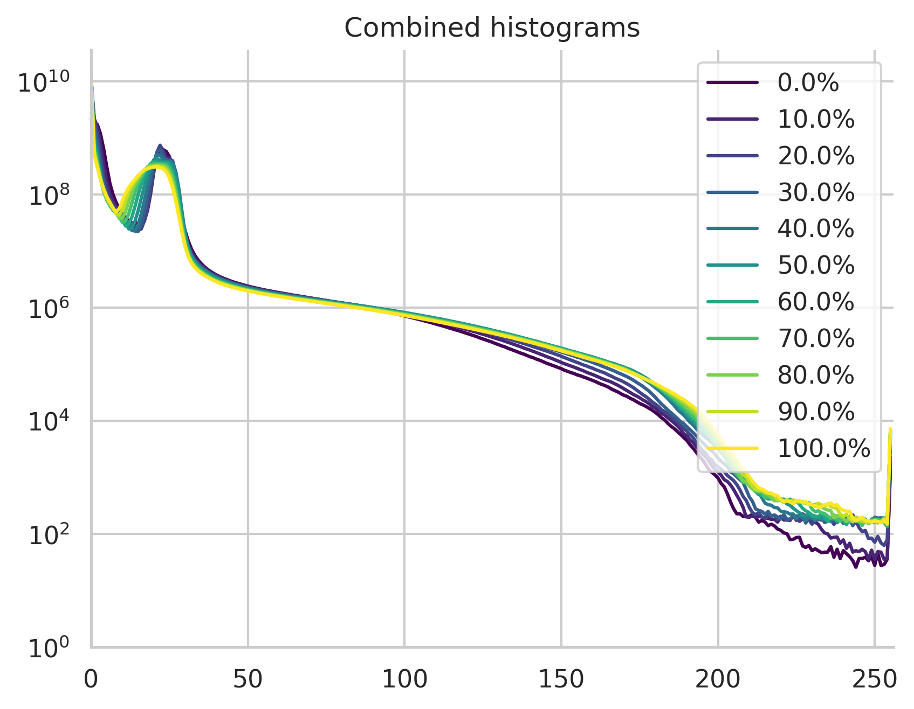

<!--
Text is copy-pasted from the email we got, block-quoted *in toto*, answered inbetween.
Use
```bash
pandoc answer.md \
  --output=answer.pdf \
  --to=typst-citations \
  --from=markdown \
  --lua-filter=quote-style.lua \
  --citeproc \
  --bibliography="$HOME/Documents/library.bib" \
  --csl="../../build/assets/style.csl" \
  --pdf-engine=typst
```
to make a PDF with nicely styled quotes and link underlines (hat tip to ChatGPT for whipping up the lua styling filter (I only changed the color to UniBe red)) and references (using the manubot CSL in this repo)
-->

## Summary of major changes

We thank the editor and both reviewers for their careful assessment of our manuscript and the constructive comments.
Below, we quote and number all comments verbatim, and answer each one directly.

To state the contributions more precisely (AE.2, AE.4), we changed the title of the manuscript to "From multi-specimen scans to individual bones: automated extraction and efficient, label-guided segmentation of stickleback micro-CT data".

Reviewer 2 stated that the manual reordering of the detected labels is at least inelegant (R2.14, R2.15).
We improved our separation script and replaced the manual reordering of detected regions by an assignment based on each region's angle around the rotation axis. Re-running the pipeline on all 38 scans reproduces the previous output bit-for-bit; the only manual input left (compartment number to fish ID) is now stated explicitly.

Following comments on the structuring of the discussion (AE.3, R1.1, R2.2) we split the discussion into sections on data acquisition, the pipeline and its efficiency (including comparison with other multi-specimen workflows and alternative segmentation tools), and limitations.

Based on comments on the sample mounting (R2.8) and holder material (R2.11), and the question why we scanned a larger region than analyzed (R2.10), we expanded the methods section and added an explanation on the newly implemented angle-based assignment (R2.14).

The results section was corrected and clarified.
We now report the correct total dataset size (385 GB, previously misreported as 64 GB) and mention the dimensions of the cropped datasets (R1.15, R2.27).
Memory requirements and the feasibility of an ImageJ-based approach (R1.17, R2.21, R2.22), and the role of the multi-level thresholding (R2.28) were clarified.

We overhauled Figure 1 and expanded its caption (R1.2, R2.6).
Figure captions were clarified (R1.6, R1.8, R1.13); we moved one figure to the Supplementary Materials and included the missing supplementary material (R1.22).
We also more prominently linked to the exported datasets of all cropped regions available on MorphoSource.

## Associate Editor Comments to Author

### AE.1

> I would like to thank the authors for their contribution, this is an interesting study detailing a pipeline that would be of interest and use for many researchers.
> However, the manuscript does not provide sufficient evidence for the claim that this pipeline is replicable and clade-agnostic, which would require testing on different specimens, across different taxonomic groups.

We appreciate these supportive comments.
With regard to the use of the pipeline on other taxonomic groups, a full analysis is beyond the scope of the current study.
However, we have now applied the same pipeline to different species, namely *Spinachia spinachia* (with co-authors of this manuscript), and Lake Victoria and Neotropical cichlid species (manuscript in preparation, with other collaborators).
This is now mentioned in the discussion, where we also now point out that there should be no issue in applying the exact pipeline to multi-object scans where the scanned objects are separable in the top-down maximum intensity projection.

### AE.2

> The pipeline itself should be better defined.
> The abstract states "The pipeline includes separation of multi-species scans into individual regions of interest, reconstruction of targeted anatomical structures, and morphometric analyses.", but the landmarking and geometric morphometric analyses detailed are conducted using established software and methods (manual landmarking in Checkpoint, analysis in R), that are not a novel or unique part of the pipeline developed for this paper.
> The current text obscures the actual contribution of the work.

The extraction of the anatomical structures, landmarking and geometric morphometric analysis *are* conducted using established software, but are essential parts of the presented pipeline, albeit neither novel nor unique as you correctly state.
We now distinguish more clearly between the novel part (the reproducible separation of multi-specimen scans and the label-guided segmentation) and the morphometric case study demonstrating its use.
In the spirit of reproducible research, the separation pipeline is *defined* in the presented code.
The abstract and the title were changed accordingly.

### AE.3

> As discussed by Reviewer 2, the pipeline is underexplained and, as mentioned by Reviewer 1 the discussion is brief and does not sufficiently discuss the pipeline, its advantages or disadvantages.

We expanded the description of the pipeline in the Materials & Methods and the Discussion; see also our responses to R1.1 and R2.14.

### AE.4

> There is general lack of detail throughout the text: the introduction does not mention alternative methods or sufficiently explain why this pipeline was developed.
> It is true that time and resources are required to segment scans, and these factors compound as the number of specimens increases, but what does this pipeline solve uniquely or better than existing methods.

The main advantage of our separation pipeline is the end-to-end reproducibility, i.e., re-running it on the acquired data yields exactly the same output of separated specimen regions.
During this revision we changed the sorting/labeling logic of the extracted regions to make that part of the pipeline *fully* automatic (R2.14), and re-ran the separation on all scans on a local machine.
The results were bit-for-bit the same as what was present on the network folder shared by all co-authors.
The separation is applicable to any multi-object scan in which objects can be separated in the top-down axial view.
The subsequent steps are largely independent of the software used; the chosen combination of SlicerMorph and Biomedisa scales well and keeps all parts of the workflow in Free and open-source software.

We now explain the motivation for the pipeline in the Introduction and compare it with other approaches in the Discussion.

### AE.5

> There are many pieces of software used for processing scans, separating out specimens and segmentation, which could warrant discussion, including:
>
> - Segment Anything Model (SAM) and SAM2
> - Computer Vision and Deep Learning pipelines in AVIZO, Dragonfly and Slicer
> - nnInteractive
> - BounTI
> - SPROUT
> - Existing protocols in ImageJ/Fiji

Thank you for these suggestions.
The processing and separating steps in our pipeline are fully automated; the listed tools are complementary rather than alternatives to it.

- The labels needed for training Biomedisa can be created with any of these tools (3D Slicer, nnInteractive, Avizo, Dragonfly, BounTI, SPROUT).
  These tools reduce the time needed to create high-quality training labels; the SPROUT preprint [@He2025] does exactly this.
- SPROUT builds on BounTI and can use nnInteractive as its prediction backend.
- SAM/SAM2 perform well on 2D images but less so on volumetric data [@Isensee2025, Figure 7].
- Existing ImageJ/Fiji approaches are discussed in our response to R2.21.

Biomedisa can be combined with any of these as a pre- or post-processing step; we chose it because it runs as an online platform without local installation or on our institutional computing cluster.
We added this discussion of alternatives to the Discussion.

## Reviewers' Comments to Author

### Reviewer 1

#### R1.1

> Overall, this is a well-written study that will assist others in conducting similar research.
> There are just a few points I found difficult to follow, and clarifying them would be beneficial for future readers.
> A somewhat more significant criticism concerns the discussion: it is very brief and focuses primarily on the biological results, while neglecting the method or pipeline described.
> A more detailed discussion of the advantages and disadvantages, as well as the potential applications and limitations of the method (when it works, when it does not, and why), would be helpful for the readership.

We thank the reviewer for the positive assessment and the constructive criticism.
We agree that the Discussion focused too heavily on the biological results.
It now contains dedicated sections describing data acquisition, the pipeline itself and its efficiency, and discusses limitations of our approach.

#### R1.2

> Perhaps some of the following questions could be addressed in this context:
>
> Figure 1 is impossible to read.
> Please enlarge the text and maybe add some description in the caption.

We redesigned the workflow figure as a swimlane layout, giving it more room, and improved its caption.

#### R1.3

> Line 98ff: “DNA was extracted […], and subsequent PCR genotyping […] was performed […]”.
> Why is this relevant to this study?

Sexual dimorphism is a potential explanatory factor for ceratobranchial shape, and sex assignments from preserved specimens can be difficult; genotyping gives a less ambiguous designation.
We updated this paragraph.

#### R1.4

> Line 119: You mention that different voltage and current were used for one scan, due to operator error.
> How did that affect the scan quality and subsequent segmentation?

There was no discernible difference in scan quality, only a slightly longer scan time.
Since the threshold for segmentation was adjusted per specimen, the downstream segmentation was not affected either.
We added this to the Methods.

#### R1.5

> Line 123: You scanned 3 fields of view.
> How were they merged/stacked?

Merging of the substacks is performed automatically in the reconstruction software NRecon provided by Bruker.

#### R1.6

> Line 129: I don’t understand what you mean by “shown extracted”.

The labels are "extracted" from the MIP by image processing and shown as yellow overlays for quality control.
We reworded the sentence and now state where the labels are highlighted.
For consistency, the labels are now yellow in all figures (previously red in Figure 2).

#### R1.7

> Line 130: I assume it should be “Figure 4” not just “4”.

We fixed the internal reference.

#### R1.8

> Line 132: Which tool/software was used to render Figure 2?

We visualized the multi-specimen scan with Dragonfly 3D World, now stated in the figure caption.

#### R1.9

> Line 155: First, “Simple” is very subjective.
> I would remove it.

Replaced with the more precise "connected region labeling".

#### R1.10

> Line 155: Second, I understand you binarized the data using Otsu thresholding and then used skimage.measure.label to label connected components (each fish) with an individual label value.
> Thinking in 3D, I agree that the fish should not overlap, because each one is located in a dedicated container.
> In Lines 254-255 you also write that the regions don’t overlap.
> But looking at your Figure 4, it seems that fish 2 and 3 are touching.
> So how is this separation process still possible?

The reviewer is correct that the fish do not overlap in 3D.
Because the 3D-printed holder is slightly warped, it is tilted by about 3.25° in the scanner (see the stitched preview image below), so the tail of fish 2 overlaps the head of fish 3 in the axial MIP only.
Since each region is cropped with a 50-pixel buffer, neighboring cropped regions can overlap and may contain a small part of the adjacent fish; this did not affect any further analysis.



#### R1.11

> Figure 4: I assume the numbers in the right image are the label values automatically assigned by skimage.
> Is that correct.
> Were they assigned manually to the correct fish ID (which I assume are the yellow numbers)?

Yes: the numbers in black circles are the labels assigned by `skimage.measure.label` in raster order; the yellow numbers are those printed on the holder, highlighted by our script.
The assignment of detected regions to compartments is now automatic, based on their angle around the rotation axis (see R2.14); the compartment number is then mapped to the fish ID from a small text file per scan.
This is now described in the Methods.

#### R1.12

> Line 169: I don’t think skimage.measure.regionprops is “labeling” the data.
> It only provides properties of the regions labeled by skimage.measure.label.

Correct; we removed the sentence by improving the paragraph above to remove redundancies.

#### R1.13

> Figure 6: I understand that this is a verification step to ensure the cropping worked correctly.
> But I don’t understand what was done.
> To me, both rows show the exact same extracted region from the MIP images.
> What could potentially have gone wrong, and what would the images look like?

As specified in the figure caption both rows *must* show the same image (except the yellow highlight).
The top row is cropped from the MIP of the multi-specimen scan, the bottom is the MIP calculated from each cropped dataset.
We expanded the caption accordingly.

#### R1.14

> Figure 8: Were all the different structures used for model training or only CB1 and CB2.
> And were CB1 and CB2 labeled differently or with the same label value.
> Figure 8 suggests they have the same value.

All structures were used for model training, with all ceratobranchials (including CB1 and CB2) having the same value, yet still distinguishable in the scan output.
We have reworded our text to ensure clarity in this section.

#### R1.15

> Line 212: Could you provide the range of image dimensions of the cropped images.
> From the supplementary data, I gathered that x and y dimensions are approximately 500 voxels, but what about the z dimension?

The exported datasets range from 1743 × 486 × 722 voxels (anteroposterior length × x × y) to 5398 × 1322 × 862 voxels, with a median of about 4250 × 650 × 650 voxels, stored as uncompressed 8-bit volumes.

The smallest crop is from a scan that did not turn out well (see [this README file of one of these scans](https://anonymous.4open.science/r/sticklebacks-01A4/logfiles/Sticklebucket_14/README.md)), but was nonetheless a scan where we used the scanned head-region of the fish for extracting individual bones.
Other datasets span the whole fish, so the *median* size of the cropped regions is a more representative estimate of the sizes.

While compiling these numbers, we noticed that the total size was misreported: it is 385 GB, not 64 GB.
Both are now correctly stated in the Results.

> Were the regions manually or automatically cropped to the head, or was only the field of view containing the head processed?
> If the entire fish was processed there might be substantial resizing artifacts, because the default behavior of Biomedisa is to resample the input data to 256x256x256 voxels before processing.

The reviewer is correct.
We used Biomedisa with its default settings, so all datasets were resampled to 256 × 256 × 256 voxels for training and prediction, and the predicted labels were scaled back to the original resolution.
The landmarks describe the overall shape of CB1 and CB2 (end points and curves along the bones); all specimens were processed identically, and remaining errors (adjacent bones merged in the prediction) were corrected manually.
We therefore do not expect the resampling to affect the comparisons between lakes and ecotypes.
We now state the resampling in the Methods and mention very fine structures as a limitation in the Discussion.

#### R1.16

> How were the training labels created.
> Manually?

Yes, all training labels were created and checked by hand in 3D Slicer; we clarified this in the Methods.

#### R1.17

> Line 262: “7 GB on disk and reported as 35.4 GB”.
> This suggests that the data is compressed.
> Maybe mention the compression method and could you also provide the data type (e.g., 16-bit unsigned integer)?

The reconstructions are stored as losslessly compressed 8-bit PNG files; the cropped `nrrd` datasets are uncompressed 8-bit volumes.
Fiji reports the size of the decompressed stack in memory (for the example now used in the text: 3064 × 3064 pixels × 4891 slices × 1 byte = 42.8 GB, versus 8.5 GB on disk).
This memory is only needed when loading the full stack, not for a virtual stack; we clarified this in the Results.

#### R1.18

> Table 1: Maybe call it “Our Pipeline Time”.

Updated.

#### R1.19

> In all of your test statistics, the symbol identifying the test statistic is missing.

We believe that this may have been an issue in file conversion, as the generated PDF correctly showed all formulas.
It has now been corrected.

#### R1.20

> Line 323: “The The benthic”.
> Redundant “The”

Fixed (also in the other captions).

#### R1.21

> Line 341: species/species.
> Redundant “species”

This redundancy was introduced during anonymization; fixed.

#### R1.22

> Line 350: There are no supplementary figures.

We apologize for the error in supplementary material uploads; we have attached these with the updated manuscript files to ensure they are included appropriately.

### Reviewer 2

#### R2.1

> This paper presents a pipeline that make it possible to analyse a large corpus (215 specimens) of fishes with geometric morphometrics on internal structures only accessible with micro-CT.
> The time constraints that led to develop the pipeline are well explained.
> Most of the pipeline runs with Jupyter notebooks and open libraries or softwares, which is appreciated when a project involves different collaborators in an OpenScience approach.

We thank the reviewer for these kind general comments.
We also thank the reviewer for their detailed review of our pipeline, which led to several critical improvements.

#### R2.2

> The paper lacks a few references to protocols aiming at optimizing the workflow of CTscanning multiple specimens, focusing on either mounting specimens together or automatizating the post-processing the data, or both.
> Discussion would benefit from comparisons with those protocols (fishes in the #ScanAllFish project, other high-throughput micro-CT scanning for 3D morphometrics studies).

We now compare our approach with other high-throughput micro-CT protocols, be it for workflows scanning many small shells or the fish-scanning effort of the Summers lab (#ScanAllFish).
Since the work presented in this manuscript is only *one* of the many projects ongoing in our lab, streamlining (and automation) of the separation process mattered even more.
In the spirit of #ScanAllFish, all 215 datasets of this study are openly available on MorphoSource.

#### R2.3

> The pipeline could be further optimized, some steps are redundant or not justified enough.
> The code relies too much on hard-written adjustments or manual corrections, especially in the separation notebook.

Thanks to the reviewer's detailed comments, we replaced the manual reordering of detected regions with an automatic, angle-based assignment (see R2.14).
Apart from noting which fish is in which compartment, the separation is now fully automatic, and its output is unchanged.
This improvement also prompted the change of the manuscript title.
We thank the reviewer for raising this points, which allowed us to greatly improve the quality and robustness of the separation pipeline, without altering its output.

#### R2.4

> As such, the pipeline is sometimes confusing.
> I suggest some revisions to clarify the authors' approach and make the pipeline more robust.
> The claim that the pipeline is replicable and clade-agnostic should be adapted to the amount of revisions that can be done to reach this objective.

With the angle-based assignment, the separation works for any sample holder with compartments at known angles around the rotation axis (with a configurable number of compartments; we used six for all but one scan).
The only manual inputs are the mapping of compartment to specimen ID, which has to be recorded anyway, and the number of compartments.
We have already applied the separation to other fish species (see AE.1).
We therefore consider the *separation* step object-agnostic, provided the specimens are separable in the axial MIP, and now state these conditions explicitly in the Discussion.

#### R2.5

> Line 71-72: « Furthermore, accessing these structures requires destruction of the mandibular and cranial anatomy, preventing subsequent analyses of these features” refers to the destructive dissection of the structures of interest and does not fit in this paragraph where the authors describe the non-destructive benefits of micro-CT.

We agree and removed the sentence while revising the paragraph.

#### R2.6

> Figure 1: The font is too small, please consider editing a more readable figure.
> The sample positioning in the holder is a required step in the workflow that should be visible between sample collection and microCT imaging.

Please see our response to R1.2.
The caption now also mentions the mounting of the fish in the sample holder; we kept the figure itself free of this step, which is part of every micro-CT scan, to keep it readable.

#### R2.7

> Line 83: the title seems incomplete

This section title was corrupted during anonymization; it is "Sample Procurement and Preparation" again.

#### R2.8

> Sample positioning
> Extra information is needed regarding the specimens.
> The authors describe individual bags with a formalin solution and later show pictures of tubes holding a fish and some liquid.
> How where the fishes placed into the sample holder to ensure that they won’t create a movement artefact and/or dry as the scans duration is 10h?
> There is a mention of foam in the notebook, can the authors elaborate ?

For scanning, each fish was taken out of its labeled tube, wrapped lightly in melamine resin foam (Basotect; virtually X-ray transparent and mechanically stable) and placed head-first into its compartment; the compartment number was recorded in the lab book.
The foam was then moistened with formalin and the holder sealed with Parafilm, which prevents both movement and drying.
We added this to the Methods.

#### R2.9

> The sample positioning and reporting in the lab book is a time-consuming task that should be taken into account in the time estimates in Table 1.

Putting the fish into the sample holder, reporting in the lab book and sample positioning took no more than 30\ minutes per scan, making it a negligible contribution to the scanning time.
Since this step is required for every micro-CT scan, manual or automated, we did not add it to Table 1.

#### R2.10

> There is focus in this study on the feeding structures and the branchial anatomy but it is not explained why the authors chose to scan the whole fishes with all the consequences in terms of scanning time and post-processing heavy datasets.
> From Figure 3., we can see that almost half the dataset is outside these regions of interest, so probably two fields of view instead of three along the rotation axis would have been enough.
> This needs to be addressed and justified.

The datasets will also be used in follow-up studies of other anatomical regions, which required us to scan the total anteroposterior length of each fish.
In addition, the 3D-printed compartment labels have to be within the field of view (visible as the upside-down "1" in (now) Figure 6) to link each cropped dataset to the labeled tube, lab book notes and photos.
We added this justification to the Methods.

#### R2.11

> I could not acess the OpenScad files due to the anonymization process of the paper.
> A picture of the sample holder containing the fishes would be appreciated.
> The printing material can be documented as it needs to be radio-transparent enough.
> What are the benefits of the petal design when the central zone needs to be later removed in the separation process ?

A temporary interactive preview of the holder is available on [OpenSCAD Studio](https://openscad-studio.pages.dev/s/ue5Aw3bW).
The original files are [shown as preview in the de-anonymized GitHub repository](https://docs.github.com/en/enterprise-cloud@latest/get-started/writing-on-github/working-with-advanced-formatting/creating-diagrams#creating-stl-3d-models).
The petal structure of the holder is visible as a grayish outline in Figure 2.
The holder is printed in Clear Resin (V5) on a Formlabs printer and UV-hardened.
The X-ray attenuation of the material ([datasheet](https://media.formlabs.com/m/5fd5e7daf1460058/original/-ENUS-Clear-Resin-V5-TDS.pdf)) is close to that of soft tissue; we now state the material in the Methods.
The petal design is a compromise between ease of design, printability and handling, and it separates the specimens radially, which is what enables the automatic angle-based assignment (R2.14).

#### R2.12

> Line 126: Can the authors elaborate on why they chose not to apply any beam hardening correction .
> How did the beam hardening was checked not to have an impact on the segmentation of small bony structures close to denser structures like otoliths or remaining dense particles ?

In pilot scans, we did *not* observe classic cupping beam hardening artifacts [@Orhan2020, section 4.2.1.1]; faint streaking artifacts near the teeth and otoliths are only visible at increased contrast.

To check this, we reconstructed the head region of one scan (`BucketOfFish_H`) with beam hardening correction from 0% to 100% in 10% steps (NRecon offers no other parameter) and compared the gray value histograms and a profile across the holder wall (notebook `BeamHardening.ipynb` in the (anonymized) code repository).

The histograms differ only around gray value 20 (mostly the holder) and around 170 (bone); the latter difference affects about 5 × 10^4^ of 1.8 × 10^10^ voxels and is only visible on a logarithmic scale.



Across the uniform holder wall, the gray value varies between 18 and 23; the coefficient of variation is lowest at 20% correction and increases strongly towards 100%, indicating over-correction.
Since NRecon corrects a radial cupping and all specimens sit at nearly identical radii in the holder, any remaining effect is the same for all specimens.
We therefore consider the influence on the segmentation of the branchial elements negligible.
We show these analyses here rather than in the manuscript, since they confirm a standard reconstruction choice rather than add to the method.

.](BeamHardening.gif)

#### R2.13

> Preview notebook
> A general remark on the preview notebook is that it is not clear what scanning issues are detected then that could not have been seen while reconstructing the data in Nrecon.
> Could the authors elaborate on why the CT operator was not in charge of this check, while the specimens are still in the lab .
> It sounds counter-productive to re-open everything later and maybe having to come back to CTscan again what went wrong.
> The following steps (XY-alignment, ring removal, beam hardening, defect pixel masking, checking for overexposure) should be mandatory in a robust reconstruction protocol, before exporting the slices from Nrecon.
> MIP images could be easily generated with CTan or ImageJ using virtual stack, on the reconstruction computer for a quality assessment before storing the datasets and sending them to the collaborators.

The fish were scanned in two batches in around seven months in total (November 2023 to March 2024 and April to June 2025).
This was done in between *many* other projects on the same machine.
NRecon keeps the last used set of reconstruction parameters when a new scan is loaded, so the preview notebook mainly checks the consistency of reconstruction parameters per project.
Our notebook performs this check globally for the project instead of highlighting *scanning* issues of a single scan.
Scanning issues of single scans were corrected as soon as they were detected (a few scans were repeated).
The fish were only returned to the collaborating lab after this check, so rescans remained possible.

MIP images could indeed be generated with other tools, but this would be another manual step (or maybe a 'Task list' in CTAN or a 'macro' in ImageJ).
Since the same MIP images are the basis of the separation, we generate them in the same reproducible notebooks.

#### R2.14

> Separation notebook
> A major issue in the separation workflow is that the region detection numbers the fishes from left to right starting at the top-left of the image while the sample holder numbers the fishes from 1 to 6 counter-clockwise.
> This results in a wrong allocation as visible on Figure 4. and a need to reorder the list for each bucket, as visible in Figure 5.
> The calculated labels do not fit the sample holder labels in every 38 scans, and the labelling is different w.r.t the sizes of the fishes within their petal.
> When reviewing the notebook code, it appears that each list has been manually edited in the reorder_list function.

We thank the reviewer for this careful review of our code, and for identifying a weak spot in our pipeline.
For the two pairs of laterally adjacent compartments (2/6 and 3/5), the raster order of `skimage.measure.label` depends on the exact position of each fish and the tilt of the sample holder in the scanner.
Across our scans, 13 were detected in the default order and 25 in one of several other orders, which we had corrected by manually supplying the order per scan.
We have replaced this step; see our response to R2.15.

#### R2.15

> The statement that the extraction process is fully automatic and reproductible does not hold.
> The authors should comment on that error and how to correct the labels efficiently.
> In my opinion, the way it is handled now makes the pipeline flawed.
> As a manual reordering of the labels is needed anyway, the authors should acknowledge it and come up with a cleaner way to let the operator assign the labels within the notebook.

We agree.
Since re-running the notebook always produced the same output, we had described it as "fully automatic" without accounting for the manual reordering.
Following the reviewer's suggestion, each detected region is now assigned to the compartment whose nominal direction is closest to the angle of the region's centroid around the rotation axis.
The notebook flags scans where two regions are assigned to the same compartment or where a region deviates strongly from its nominal direction, and writes a control image of the assignment.
Applied to all scans, this reproduces the previously corrected order, so none of the datasets or downstream analyses change.
The only remaining manual input is the mapping from compartment number to fish ID, recorded during mounting and read from a text file per scan.
We revised the Methods and Results and now describe the extraction as deterministic, with the manual input stated explicitly.
The updated notebook is available in the (anonymized) repository.

#### R2.16

> In order to validate the separation method, creating a MIP of the cropped version and comparing with the full scan MIP seems enough.
> It is confusing to me why the authors go through a multilevel threshold that shows an interactive rendering within the notebook.
> The fishs are not cropped in the anterior-posterior direction and even if they were, a frontal MIP would provide enough information to check if the crop went well.
> This multilevel threshold does not seem to be later used in the segmentation process (note: it could have been loaded into 3Dslicer as a seg.nrrd file to speed up the thresholding step).
> The workflow could be simplified with discarding the interactive rendering and the need to keep a .zarr version of the cropped files.
> Dealing with storage limitations, it is quite inefficient to keep three versions of the same dataset, only the .nrrd is needed from here to the end of the pipeline and can be handled with skimage.

We agree that the axial MIP is sufficient to validate the separation, and that the multi-level thresholding and the interactive rendering are not needed for the results of this manuscript (the rendering produced (now) Figure 6).
We keep the thresholding in the notebook because the binarized datasets are used in follow-up studies; the Results now state this explicitly (see R2.28).

The `zarr` files served as intermediate storage, as they are *extremely* well suited to store n-dimensional arrays on disk and support chunking and compression, which made it easy to inspect the data in ImageJ (via [n5-ij](https://github.com/saalfeldlab/n5-ij)) and to write `nrrd` and PNG exports efficiently.
We agree that keeping several versions is inefficient; the `zarr` files have since been deleted, since they can be regenerated bit-for-bit by re-running the notebook.

#### R2.17

> Extraction of features of interest
> Does the processing time needed to segment a single fish correspond to the 10-15 minutes stated in Table 1.?
> For 51 specimens, that would represent 12.5h of manual interventions and it should be noted.
> An estimate of the time needed to train the model in Biomedisa should be provided.
> Those combined should be accounted for in the pipeline segmentation time indicated in Table 1.

Yes, segmenting one fish manually took 10--15 minutes, i.e., about 12 hours for the 51 specimens used to create the initial training dataset.
We did not supervise the training, let the machine run for 50 epochs and checked the Dice/error function outputs afterwards.
Logs show that training took 5 hours and 15 minutes on 2 NVIDIA GeForce RTX 4090 GPUs.
We added these numbers to the table.

#### R2.18

> Landmarking of Models
> The authors should explain why they did not use the SlicerMorph extension to place the landmarks and chose to use a proprietary software like Stratovan.
> For better practices, it is preferred to stay within the same software environnement, it would prevent input/output errors and save time in data transfer.
> This is especially confusing as 3Dslicer is later used for ensuring equal distances.
> And Stratovan is not free/open-source.

We agree with the reviewer about generally preferring open-source pipelines for analyses.
In this case, Stratovan in particular was used for the template-import to speed up fixed landmark placements (which far outperformed ALPACA/MALPACA modules in Slicer in our tests), with the Python-scriptable elements of Slicer to assist with the semilandmarks.
Any landmarking tool could be used for this step; we clarified this in the Methods.

#### R2.19

> Line 247: The total number of projections and reconstructions are not meaningful and should be removed.

We prefer to keep these numbers, as they document the total amount of data acquired.

#### R2.20

> 4000 images in a CTscan is far too much when only 2000 images contain the region of interest of the morphometrics study, please consider CTscanning only this ROI or running the post-processing on a crop in the anterior-posterior direction if the scan of the whole specimen is needed.

Please see our response to R2.10.
The case study itself was performed on datasets cropped to the head region.

#### R2.21

> Line 261: The justification that ImageJ could not be used is wrong.
> There is no need to use Crop3D in this workflow as the authors only crop in XY and not in Z direction.
> The workflow can be done automatically and would be reproducible with a similar approach the authors used in the detect_fish_position function:
>
> - import the images as a virtual stack into ImageJ,
> - run a Z projection of maximum intensity, threshold it to get a binary image
> - run an Analyse particles with a pixel size limit to discard the small speckels
> - add the results as ROIs in the ROI manager (each fish is a ROI with a label)
> - for each ROI, compute its bounding box, add a margin and record its coordinates in a log file for reproductibility
> - transfer the ROI on the virtual stack and crop
> The RAM usage would be up to the cropped subvolume weight, that can be handled with a standard workstation.
> Still it has to be done 6 times, so it should be run in a macro or a plugin to save operator time.

We thank the reviewer for this detailed suggestion and agree that our original statement was too strong.
Since we only crop in XY, a Fiji macro working on a virtual stack (MIP, thresholding, *Analyze Particles*, cropping each ROI with a margin and logging the coordinates) would extract the fish reproducibly and with modest memory requirements.
This is essentially the algorithm our pipeline implements, and we rewrote the paragraph in the Results accordingly.

We implemented it in Jupyter notebooks because cropping is only one of the steps from a multi-specimen scan to an identified single-fish dataset:

- regions are assigned to compartments by their angle and mapped to fish IDs; a cropped stack without a reliable fish ID is of no use for the analysis;
- for each fish, the pipeline writes the `nrrd` dataset with the voxel size in its header, a log file with the crop coordinates, and control images;
- the detection uses the same MIPs as the quality control in the preview notebook;
- all 38 scans are processed in one batch; only two scans needed user input (one with five fish, one in a three-compartment holder).

A Fiji macro could be extended to do all this, but would amount to a reimplementation of the pipeline; our contribution is the automation and documentation of the full chain, not the choice of tool for cropping.

#### R2.22

> The indication of an extra weight in Fiji might come from the software working with .tif format by default and not taking into account the compression in the .png format.

The reviewer is correct; please see our response to R1.17.

#### R2.23

> Table 1. The comment on how it would have been completely infeasible to scan each fish separately should be more salient than a side note in a table.
>In my opinion, it is the main motivation behind the authors’ developments.

We agree that this deserves a more prominent place.
Strictly speaking, scanning each fish individually would not have been infeasible: it would have taken about 90\ days instead of 16\ days of scanner time, at correspondingly higher cost.
The motivation for the pipeline was the efficient use of both scanner time and operator time.
We moved this argument from the table caption to the Discussion.

#### R2.24

> When estimating the time needed to scan a single fish, the duration would not be the same as a batch because one would need less than 3600 projections per scan.

The number of projections is given per stack (360° at 0.1° steps), so the duration per stack would be the same.
For a single fish, the smaller lateral field of view would allow either fewer projections or a smaller voxel size; the latter would also reduce the vertical field of view and thus require more stacks to cover the whole fish.

#### R2.25

> From the MIP, it seems that a single fish would fit in half the width of the field of view, thus a scan duration for a single fish would be 5h while keeping the same voxel size and exposition time.

A single fish would indeed fit into less than half the lateral field of view.
However, the features of interest require a voxel size below 20 µm, and the whole length of each fish had to be scanned (see R2.10); a long, thin specimen at this voxel size requires stacked scans regardless, which fixes the vertical field of view.
Filling the lateral field of view with six fish is therefore the most efficient use of each scan.
Even at the reviewer's estimate of 5 h per fish, scanning all fish individually would have taken about 45\ days (215 × 5\ hours), about three times our actual scan time.

#### R2.26

> Can the authors explain what is included in the 17 minutes manual time needed to split a single fish scan of a single fish ?

We loaded the PNG stack of the reconstructions of one multi-specimen scan in Fiji, generated the axial MIP and then used the selection tool to mark rectangular regions for each fish on it.
We then transferred the coordinates to the full stack, cropped and saved each region.
Cropping two complete scans (six fish each) took about 35\ minutes, i.e., about 17\ minutes per scan.

#### R2.27

> Line 290: It would be great to provide the average size of a cropped .nrrd dataset for a single fish.

Please see our response to R1.15.
The 215 `nrrd` files total 385\ GB, with a median of 1.65\ GB per fish (range 0.6--6.2\ GB); dataset size depends on fish length and on its tilt in the holder.
This is now given in the Results.

#### R2.28

> Line 293: The sentence “ This relatively simple segmentation was sufficient to extract all of the features we analyzed further and we did not have to employ more advanced thresholding methods in our separation pipeline “ is confusing.
>The separation pipeline is used to get the subvolumes, there is no extraction of features with the multi-level thresholding in this method, only a rendering.
>The extraction of features, a.k.a the segmentation process, is later done in 3Dslicer.

We agree that the sentence was misleading.
The multi-level thresholding is not used for segmenting the features of interest; it produces binarized datasets for visual checking (now Figure 6) and for follow-up studies.
We rewrote the paragraph to make clear that segmentation was performed in 3D Slicer and Biomedisa.

#### R2.29

> Figure 12: There is a typo with a double The.

Fixed; please see R1.20.

#### R2.30

> Line 376: In order to make the pipeline reproductible for larger or more dense specimens:
>
> - The separation process should only rely on contrast between the specimen and a radio-transparent sample holder, or the sample holder should be designed differently to prevent the wrong labeling of the separation process.
> - The thresholding should be robust enough to encompass a shift to different pixel values for the region of interest.
> Those are the expectations to rightfully claim that the pipeline is replicable and clade-agnostic as stated in the abstract.
> The authors should consider the amount of revisions needed to achieve this statement or correct the statement with general guidelines on what would be the limitations of the pipeline (dimensions of the specimens, conservation (dry vs in solution), only vertebrates, etc.).
> I would recommand minor revisions and a more restricted description of the taxonomic groups that the pipeline can handle in the conclusion.

The separation does not rely on the contrast between specimen and holder, but between specimens and background: the resin holder has an X-ray attenuation similar to the soft tissue of the fish, which is ignored.
With the angle-based assignment, the separation works for any holder with compartments at known angles around the rotation axis, as long as the specimens' centers are separable in the axial MIP.
Since the multi-Otsu threshold is computed from each scan's histogram, the detection adapts to differences in gray values between scans.
For segmenting other species or structures, a new training set and model are needed.
We now state these conditions and limitations in the Discussion.

## References
