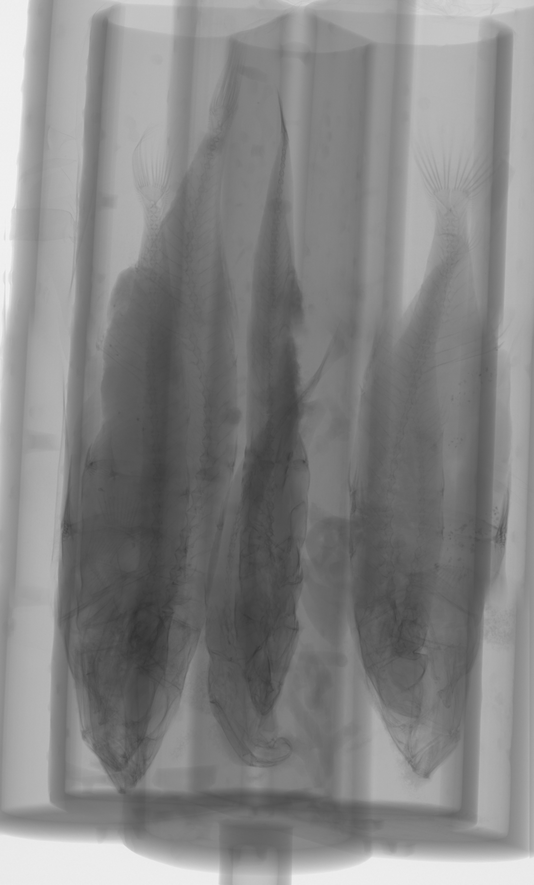
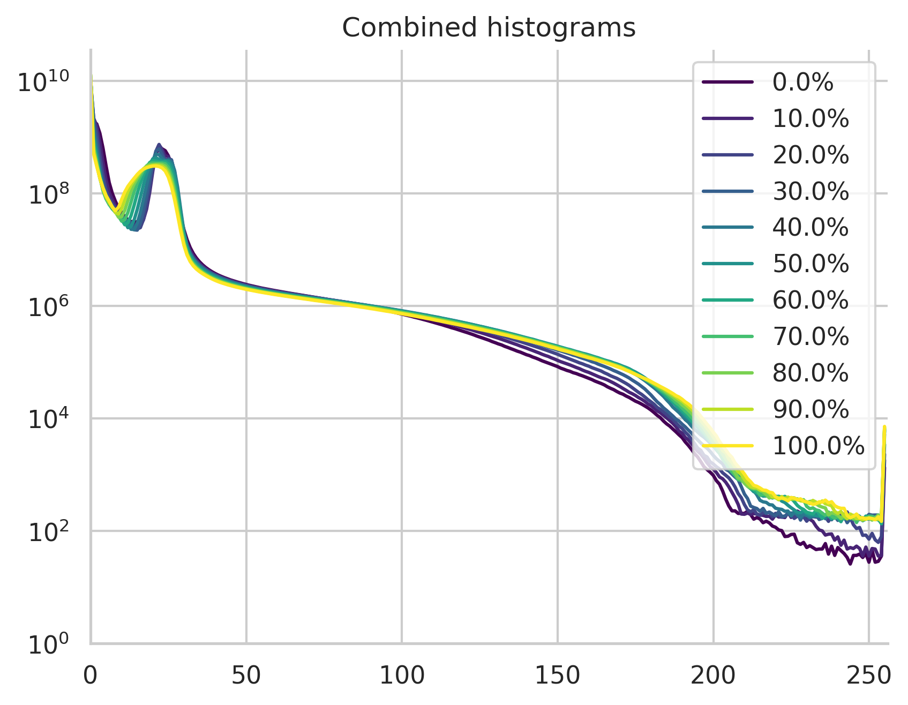
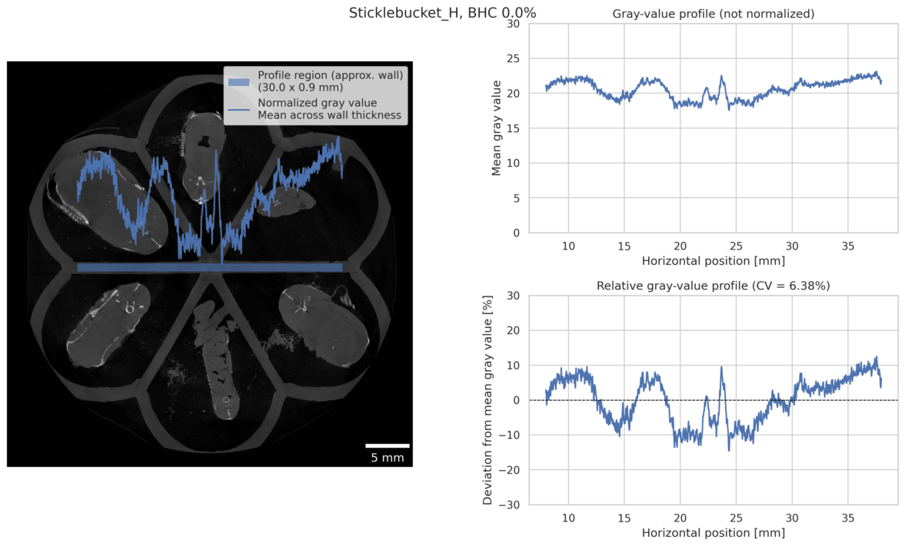

<!--
Text is copy-pasted from the email we got, block-quoted *in toto*, answered inbetween.
Use
```bash
pandoc answer.md \
  --output=output.pdf \
  --to=typst-citations \
  --from=markdown \
  --lua-filter=quote-style.lua \
  --citeproc \
  --bibliography="$HOME/P/Documents/library.bib" \
  --csl="../../build/assets/style.csl" \
  --pdf-engine=typst
```
to make a PDF with nicely styled quotes (hat tip to ChatGPT for whipping up the lua styling filter (I only changed the color to UniBe red)) and references (using the manubot CSL in this repo)
-->

# Associate Editor Comments to Author:

> I would like to thank the authors for their contribution, this is an interesting study detailing a pipeline that would be of interest and use for many researchers.
> However, the manuscript does not provide sufficient evidence for the claim that this pipeline is replicable and clade-agnostic, which would require testing on different specimens, across different taxonomic groups.

Thanks for this supportive comment, appreciated.
We have applied the same pipeline to different species already, namely *Spinachia spinachia* (with co-authors of this manuscript), and Lake Victoria and Neotropical cichlid species (manuscript in preparation, with other collaborators), so replicability and clade-agnostics are given.
In addition, the pipeline is deterministic, meaning that based on the same input images (reconstructed stack) it always produces the same outputs (cropped single-species datasets with the same size/extent, ensuring predictability and repeatability.
From the "theoretical" standpoint we see absolutely no issue in applying the exact pipeline to multi-*object* scans where the scanned objects are separable in the top-down maximum intensity projection.

> The pipeline itself should be better defined.
> The abstract states "The pipeline includes separation of multi-species scans into individual regions of interest, reconstruction of targeted anatomical structures, and morphometric analyses.", but the landmarking and geometric morphometric analyses detailed are conducted using established software and methods (manual landmarking in Checkpoint, analysis in R), that are not a novel or unique part of the pipeline developed for this paper.
> The current text obscures the actual contribution of the work.

The separation pipeline itself is *defined* in the presented code.
The extraction of the anatomical structures, landmarking and geometric morphometric analysis *are* conducted using established software, but are essential parts of the presented pipeline, albeit neither novel nor unique as you correctly state.

> As discussed by Reviewer 2, the pipeline is underexplained and, as mentioned by Reviewer 1 the discussion is brief and does not sufficiently discuss the pipeline, its advantages or disadvantages.
> There is general lack of detail throughout the text: the introduction does not mention alternative methods or sufficiently explain why this pipeline was developed.
> It is true that time and resources are required to segment scans, and these factors compound as the number of specimens increases, but what does this pipeline solve uniquely or better than existing methods.
> 
> There are many pieces of software used for processing scans, separating out specimens and segmentation, which could warrant discussion, including:
>- Segment Anything Model (SAM) and SAM2
>- Computer Vision and Deep Learning pipelines in AVIZO, Dragonfly and Slicer
>- nnInteractive
>- BounTI
>- SPROUT
>- Existing protocols in ImageJ/Fiji

# Reviewer(s)' Comments to Author:
## Reviewer: 1

> Overall, this is a well-written study that will assist others in conducting similar research.
> There are just a few points I found difficult to follow, and clarifying them would be beneficial for future readers.
> A somewhat more significant criticism concerns the discussion: it is very brief and focuses primarily on the biological results, while neglecting the method or pipeline described.
> A more detailed discussion of the advantages and disadvantages, as well as the potential applications and limitations of the method (when it works, when it does not, and why), would be helpful for the readership.
>Perhaps some of the following questions could be addressed in this context:

> Figure 1 is impossible to read.
> Please enlarge the text and maybe add some description in the caption.

#45

> Line 98ff: “DNA was extracted […], and subsequent PCR genotyping […] was performed […]”.
> Why is this relevant to this study?

#49

> Line 119: You mention that different voltage and current were used for one scan, due to operator error.
> How did that affect the scan quality and subsequent segmentation?

#50
There's no discernible difference in the outcome, since the segmentation is based on thresholding the datasets.
This threshold was tweaked for each of the specimens anyways.
The scan quality was not affected visibly, but the scan did take a little bit longer though.
We added a bit of explanation in the text.

> Line 123: You scanned 3 fields of view.
> How were they merged/stacked?

Merging of the substacks is performed automatically in the reconstruction software NRecon provided by Bruker.
The merging does correct for minute differences in rotation and usually works absolutely flawlessly by blending the overlapping regions in the reconstructed stack, so there are also no cone-beam reconstruction artifacts discernible.

> Line 129: I don’t understand what you mean by “shown extracted”.

As a non-native English writer we've chosen the wrong word here.
The labels are "extracted" from the MIP by image processing and shown as (yellow) highlights over the image to enable quality assurance.
We reformulated the sentence and specified where the labels are shown/highlighted.
This also lead to a change in the 3D visualization, as the red labels there were simply an "artistic" choice; the labels are now also yellow in that figure.
So the labels are now highlighted in yellow in the Dragonfly visualization, highlighted yellow by our script and simply visible in the napari visualization of the extracted region.

> Line 130: I assume it should be “Figure 4” not just “4”.

Fixed in https://github.com/habi/sticklebacks-manuscript/commit/a11b1d6674a7956df60d6bd66f4d4eec1dc0f9ca

> Line 132: Which tool/software was used to render Figure 2?

#54
We visualized the multi-specimen scan with Dragonfly 3D World.
This is now mentioned in the figure caption.

> Line 155: First, “Simple” is very subjective.
> I would remove it.

Removed by making it more precise, e.g. not "simple labeling", but "connected region labeling".

> Line 155: Second, I understand you binarized the data using Otsu thresholding and then used skimage.measure.label to label connected components (each fish) with an individual label value.
> Thinking in 3D, I agree that the fish should not overlap, because each one is located in a dedicated container.
> In Lines 254-255 you also write that the regions don’t overlap.
> But looking at your Figure 4, it seems that fish 2 and 3 are touching.
> So how is this separation process still possible?

Your assumptions about the fish not overlapping in are correct in three-dimensional space.
Due to slight warping of the 3D-printed sample holder (due to age, temperature and x-ray exposure), it is not aligned completely vertical in the machine during a scan.
This is visible in the (automatically stitched) preview image (from 3 subscans) shown below, where the sample holder is "tilted" by approximately 3.25° off the vertical.
Even though the fish are located in a dedicated compartment in the sample holder, the tail of the fish in compartment 2 is just about overlapping the head of the fish in compartment 3.
They do overlap *only* in the top-down MIP image, but do *not* overlap in 3D space.
Since the region of the fish are individually cropped out of the large datasets *with* a buffer of +50 pixels in each direction the extracted regions *do* overlap in some cases, even if the fish don't overlap.
As a consequence, this also means that one extracted region could contain a small region of the fish in the adjacent compartment, but this has not been an issue in the further analysis of the cropped datasets.



> Figure 4: I assume the numbers in the right image are the label values automatically assigned by skimage.
> Is that correct.
> Were they assigned manually to the correct fish ID (which I assume are the yellow numbers)?

#61
Your assumption is mostly correct, the labels in the black circles are the ones assigned by `skimage.label`.
The yellow numbers in the left panel of the Fig. 4--6 (and red ones in Fig. 2) are the ones "imprinted" on the sample holder by the 3D printer, simply highlighted on this image in yellow, by a step in our script (not described in detail in the manuscript).
Assignment/Matching of compartment number to detected label to fish ID was performed manually on the first half of the scans and performed in the script for the second half of the scans.
The matching for the second half of the scans was performed by writing a small text file matching compartment number to fish ID, where the script then read this file.
We tried to improve the explanation in the manuscript text, but deliberately left out how the mapping is performed exactly to now over-complicate the explanation.

> Line 169: I don’t think skimage.measure.regionprops is “labeling” the data.
> It only provides properties of the regions labeled by skimage.measure.label.

Thanks for highlighting this wrong statement.
We've completely removed that sentence by improving the paragraph above to remove redundancies.

> Figure 6: I understand that this is a verification step to ensure the cropping worked correctly.
> But I don’t understand what was done.
> To me, both rows show the exact same extracted region from the MIP images.
> What could potentially have gone wrong, and what would the images look like?

#63
As specified in the figure caption both rows *must* show the same image (except the yellow highlight), as the top row shows the regions cropped from the originally generated MIP of the multi-specimen scan and the bottom row shows the MIP individually created from the cropped regions.
We've expanded the figure caption a bit with the aim to clarify it.

> Figure 8: Were all the different structures used for model training or only CB1 and CB2.
> And were CB1 and CB2 labeled differently or with the same label value.
> Figure 8 suggests they have the same value.

#64, asked Ben

> Line 212: Could you provide the range of image dimensions of the cropped images.
> From the supplementary data, I gathered that x and y dimensions are approximately 500 voxels, but what about the z dimension?
> Were the regions manually or automatically cropped to the head, or was only the field of view containing the head processed?
> If the entire fish was processed there might be substantial resizing artifacts, because the default behavior of Biomedisa is to resample the input data to 256x256x256 voxels before processing.

You are correct, that the the x- and y-dimensions of the cropped datasets are approximately 500 voxels.
We looked at the sizes of the exported files in detail.
The smallest export is 486 x 722 x 1743 pixels (x, y, z), the largest 1322 x 862 x 5398 voxels, and the median export is 512 x 840 x 3857 voxels.

The smallest sized crop is a crop from a scan that one is actually from a scan that didn't turn out good (see https://anonymous.4open.science/r/sticklebacks-01A4/logfiles/Sticklebucket_14/README.md), but was nonetheless the one we used for extracting the rakers.
The same folder does contain datasets spanning the whole fish, so the *median* size of the cropped regions is a better estimate of the sizes.

For the analysis in Biomedisa, all datasets were further *cropped* to only include the head, so no resampling was performed by Biomedisa.

> How were the training labels created.
> Manually?

#57, asked Ben

> Line 262: “7 GB on disk and reported as 35.4 GB”.
> This suggests that the data is compressed.
> Maybe mention the compression method and could you also provide the data type (e.g., 16-bit unsigned integer)?

#56

> Table 1: Maybe call it “Our Pipeline Time”.

Thanks, updated.

> In all of your test statistics, the symbol identifying the test statistic is missing.

#65, asked Ben.

> Line 323: “The The benthic”.
> Redundant “The”

Thanks for notifying us about that.
We edited the caption(s) according to the Writefull suggesion and completely removed the the's.

> Line 341: species/species.
> Redundant “species”

This redundancy was unnecessarily introduced during anonymization or by the Writefull editing step, when we search-and-replaced some words.
The sentence has been slightly changed to avoid it to happen again.

> Line 350: There are no supplementary figures.

#55, asked Ben

## Reviewer: 2

> This paper presents a pipeline that make it possible to analyse a large corpus (215 specimens) of fishes with geometric morphometrics on internal structures only accessible with micro-CT.
> The time constraints that led to develop the pipeline are well explained.
> Most of the pipeline runs with Jupyter notebooks and open libraries or softwares, which is appreciated when a project involves different collaborators in an OpenScience approach.
> The paper lacks a few references to protocols aiming at optimizing the workflow of CTscanning multiple specimens, focusing on either mounting specimens together or automatizating the post-processing the data, or both.
> Discussion would benefit from comparisons with those protocols (fishes in the #ScanAllFish project, other high-throughput micro-CT scanning for 3D morphometrics studies).
> The pipeline could be further optimized, some steps are redundant or not justified enough.
> The code relies too much on hard-written adjustments or manual corrections, especially in the separation notebook.

> As such, the pipeline is sometimes confusing.
> I suggest some revisions to clarify the authors' approach and make the pipeline more robust.
> The claim that the pipeline is replicable and clade-agnostic should be adapted to the amount of revisions that can be done to reach this objective.

> Line 71-72: « Furthermore, accessing these structures requires destruction of the mandibular and cranial anatomy, preventing subsequent analyses of these features” refers to the destructive dissection of the structures of interest and does not fit in this paragraph where the authors describe the non-destructive benefits of micro-CT.

> Figure 1: The font is too small, please consider editing a more readable figure.
> The sample positioning in the holder is a required step in the workflow that should be visible between sample collection and microCT imaging.

Reviewer1 also noted that the font size is too small, we've updated the figure.
As 'sample positioning' is *always* a step in microCT imaging, we deliberately omitted it from the workflow and would like to keep omitting it to not clutter the workflow image more.

> Line 83: the title seems incomplete

This wrong section title was probably introduced during anonymization or by the Writefull editing step, when we search-and-replaced some words.
We are sorry for that, as in our original manuscript the section title was always "Sample Procurement and Preparation" and still is so.

> Sample positioning
> Extra information is needed regarding the specimens.
> The authors describe individual bags with a formalin solution and later show pictures of tubes holding a fish and some liquid.
>How where the fishes placed into the sample holder to ensure that they won’t create a movement artefact and/or dry as the scans duration is 10h?
> There is a mention of foam in the notebook, can the authors elaborate ?

The specimen were stored in single, labeled (tea) bags in formalin-filled jars at the Institute of Ecology and Evolution, several fish together in one jar.
For scanning, Ben Sulser singled the fish out into labeled falcon tubes and brought the fish over to the Institute of Anatomy.
For scanning, David Haberthür took out each fish from its tube, wrapped it lightly in Basotect (a melamine resin foam, which is virtually transparen to x-rays, and quite stable) and put the fish heads-down into the compartments, noting which fish ID went into which compartment in the lab book.
After putting all 6 fish for one scan into the holder, the foam was moistened with formalin and the holder was sealed with Parafilm.
Wrapping the fish in Basotect avoids movement artefacts, and moistening the foam and sealing the holder with Parafilm avoids any drying.
We added a paragraph to detail this into the manuscript and thank the reviewer for bringing up these missing details.

> The sample positioning and reporting in the lab book is a time-consuming task that should be taken into account in the time estimates in Table 1.

Putting the fish into the sample holder, reporting in the lab book and sample positioning really didn't take longer than 30 minutes for each scan, making it a negligible contribution to the scanning time.
We thus would like to kindly refrain from ading this to our timing table, since this is technically included in *every* tomographic scan, not only in our manuscript.

> There is focus in this study on the feeding structures and the branchial anatomy but it is not explained why the authors chose to scan the whole fishes with all the consequences in terms of scanning time and post-processing heavy datasets.
> From Figure 3., we can see that almost half the dataset is outside these regions of interest, so probably two fields of view instead of three along the rotation axis would have been enough.
> This needs to be addressed and justified.

> I could not acess the OpenScad files due to the anonymization process of the paper.
> A picture of the sample holder containing the fishes would be appreciated.
> The printing material can be documented as it needs to be radio-transparent enough.
> What are the benefits of the petal design when the central zone needs to be later removed in the separation process ?

#68
- A preview (temporary, *without* the connector to the machine) is available here: https://openscad-studio.pages.dev/s/ue5Aw3bW, the "original" copy is shown in the de-anonymized GitHub repository.
- Formlabs clear resin details: https://media.formlabs.com/m/5fd5e7daf1460058/original/-ENUS-Clear-Resin-V5-TDS.pdf
  The material *is* radiotransparent enough, otherwise our process would not have worked...
- Petal design is a balance between ease of generation, printing optimization and handling.

> Line 126: Can the authors elaborate on why they chose not to apply any beam hardening correction .
> How did the beam hardening was checked not to have an impact on the segmentation of small bony structures close to denser structures like otoliths or remaining dense particles ?

We performed pilot scans for this study and did *not* observe classic classic cupping beam hardening artefacts, as specified for example in [@Orhan2020, section 4.2.1.1].
Faint streaking artefacts close to the teeth and otoliths are visible in the reconstructions, but only discernible by eye if the contrast/brightness of the reconstructions is increased.
But we also did *not* fully study the influence of no or very moderate beam hardening correction through the full pipeline and kindly refrain from doing so.
The influence of the beam hardening correction as explained below on the segmentation and cleaning of the elements of the branchial apparatus using a combination of thresholding and "Split Islands" as specified in the manuscript are in our opinion *completely* negligible.

Nonetheless, now that you highlighted this potential issue we looked at it in a bit more detail.
We thus reconstructed the head-region of one multi-specimen scan (`BucketOfFish_H`) with beam hardening correction varying from 0% to 100% in 10% steps (NRecon only allows for setting the correcion between 0% and 100%, no further parameters can be tuned).
Unsing a custom made notebook (`BeamHardening.ipynb` in the (anonymized) repository), we extracted both the histograms of the regions (2001 x 3064 x 3064 px) and plotted the gray value mean across the horizontal wall of the holder in one of the reconstructions.

The gray value histograms of the regions reconstructed with different beam hardening corrections *do* show differences, but the discernible differences are present in the gray value ranges around 20 (for the plastic in the holder mostly) and around 170 (the bone region).
The differences in the bone region are only very minute and really only visible/discernible in the plot due to the logarithmic scale, as seen below.
Keep in mind that 5 x 10^4 voxels that show the difference are *very* few compared to the 1.8 x 10^10 voxels of these whole datasets.



Plotting the gray value profile mean across the horizontal plastic wall of the multi-specimen holder with increased contrast shows that this gray value varies from 18--23, and---if looking really hard---a very slight cupping might be visible in the completely uniform material at *no* beam hardening correction.
The coefficient of variation of the gray value mean through the wall is at its lowest when the beam hardening correction is performed at 20% and increases greatly when the correction is increased to 100%, showing pronounced over-correction.
Additionally, since the beam hardening correction in NRecon corrects for a radial gray value cupping effect, the influence of the correction on the specimens aligned radially in the multi-specimen holder at nearly identical radii is even more negligible.
In all honesty, we still believe that *no* beam hardening correction was necessary for the reconstruction of these datasets.




> Preview notebook
> A general remark on the preview notebook is that it is not clear what scanning issues are detected then that could not have been seen while reconstructing the data in Nrecon.
> Could the authors elaborate on why the CT operator was not in charge of this check, while the specimens are still in the lab .
> It sounds counter-productive to re-open everything later and maybe having to come back to CTscan again what went wrong.
> The following steps (XY-alignment, ring removal, beam hardening, defect pixel masking, checking for overexposure) should be mandatory in a robust reconstruction protocol, before exporting the slices from Nrecon.
> MIP images could be easily generated with CTan or ImageJ using virtual stack, on the reconstruction computer for a quality assessment before storing the datasets and sending them to the collaborators.

#69

> Separation notebook
> A major issue in the separation workflow is that the region detection numbers the fishes from left to right starting at the top-left of the image while the sample holder numbers the fishes from 1 to 6 counter-clockwise.
> This results in a wrong allocation as visible on Figure 4. and a need to reorder the list for each bucket, as visible in Figure 5.
> The calculated labels do not fit the sample holder labels in every 38 scans, and the labelling is different w.r.t the sizes of the fishes within their petal.
> When reviewing the notebook code, it appears that each list has been manually edited in the reorder_list function.

> The statement that the extraction process is fully automatic and reproductible does not hold.
> The authors should comment on that error and how to correct the labels efficiently.
> In my opinion, the way it is handled now makes the pipeline flawed.
> As a manual reordering of the labels is needed anyway, the authors should acknowledge it and come up with a cleaner way to let the operator assign the labels within the notebook.

> In order to validate the separation method, creating a MIP of the cropped version and comparing with the full scan MIP seems enough.
> It is confusing to me why the authors go through a multilevel threshold that shows an interactive rendering within the notebook.
> The fishs are not cropped in the anterior-posterior direction and even if they were, a frontal MIP would provide enough information to check if the crop went well.
> This multilevel threshold does not seem to be later used in the segmentation process (note: it could have been loaded into 3Dslicer as a seg.nrrd file to speed up the thresholding step).
> The workflow could be simplified with discarding the interactive rendering and the need to keep a .zarr version of the cropped files.
> Dealing with storage limitations, it is quite inefficient to keep three versions of the same dataset, only the .nrrd is needed from here to the end of the pipeline and can be handled with skimage.

#71

> Extraction of features of interest
> Does the processing time needed to segment a single fish correspond to the 10-15 minutes stated in Table 1.?
> For 51 specimens, that would represent 12.5h of manual interventions and it should be noted.
> An estimate of the time needed to train the model in Biomedisa should be provided.
> Those combined should be accounted for in the pipeline segmentation time indicated in Table 1.

> Landmarking of Models
> The authors should explain why they did not use the SlicerMorph extension to place the landmarks and chose to use a proprietary software like Stratovan.
> For better practices, it is preferred to stay within the same software environnement, it would prevent input/output errors and save time in data transfer.
> This is especially confusing as 3Dslicer is later used for ensuring equal distances.
> And Stratovan is not free/open-source.

#74

> Line 247: The total number of projections and reconstructions are not meaningful and should be removed.

We kept the exact numbers in the manuscript, as we *do* think they are meaningful, to assess the total data acquired.

> 4000 images in a CTscan is far too much when only 2000 images contain the region of interest of the morphometrics study, please consider CTscanning only this ROI or running the post-processing on a crop in the anterior-posterior direction if the scan of the whole specimen is needed.

The presented case study analyzing the internal branchial anatomy was focusing on cropped datasets only covering the region of interest, e.g. the head of the fish.
Further projects dealing with the same acquired datasets focus on other parts of the anatomy, so we *had* to acquire datasets covering the whole length of all the single fish scanned together in the same multi-specimen scan.
To be able to separate the scans we also had to include the 3D printed label in the visible field of view, otherwise we would not have been able to map the correspondence of the scanned regions with the ID of the scanned fish.

> Line 261: The justification that ImageJ could not be used is wrong.
> There is no need to use Crop3D in this workflow as the authors only crop in XY and not in Z direction.
> The workflow can be done automatically and would be reproducible with a similar approach the authors used in the detect_fish_position function:
> - import the images as a virtual stack into ImageJ, 
> - run a Z projection of maximum intensity, threshold it to get a binary image
> - run an Analyse particles with a pixel size limit to discard the small speckels
> - add the results as ROIs in the ROI manager (each fish is a ROI with a label)
> - for each ROI, compute its bounding box, add a margin and record its coordinates in a log file for reproductibility
> - transfer the ROI on the virtual stack and crop
> The RAM usage would be up to the cropped subvolume weight, that can be handled with a standard workstation.
> Still it has to be done 6 times, so it should be run in a macro or a plugin to save operator time.
>
> The indication of an extra weight in Fiji might come from the software working with .tif format by default and not taking into account the compression in the .png format.

> Table 1. The comment on how it would have been completely infeasible to scan each fish separately should be more salient than a side note in a table.
>In my opinion, it is the main motivation behind the authors’ developments.

#72, major :) !

> When estimating the time needed to scan a single fish, the duration would not be the same as a batch because one would need less than 3600 projections per scan.

The duration of the scan would be the same, as the number of projections is given *per* stack (360° scanning rotation at 0.1° rotation step).
Since we would have needed to cover a smaller *lateral* field of view for a scan of a single fish, we could have either increased the rotation step to really reduce the scanning time by acquiring less projections, or increase the resolution of the scan by decreasing the distance of the object to the source.
Since such a reduction would also decrease the vertical field of view, we would have needed to acquire more stacks to cover the whole length of the fish.

>From the MIP, it seems that a single fish would fit in half the width of the field of view, thus a scan duration for a single fish would be 5h while keeping the same voxel size and exposition time.

> Can the authors explain what is included in the 17 minutes manual time needed to split a single fish scan of a single fish ?

> Line 290: It would be great to provide the average size of a cropped .nrrd dataset for a single fish.

Kinda a duplicate of https://github.com/habi/sticklebacks-manuscript/issues/59

> Line 293: The sentence “ This relatively simple segmentation was sufficient to extract all of the features we analyzed further and we did not have to employ more advanced thresholding methods in our separation pipeline “ is confusing.
>The separation pipeline is used to get the subvolumes, there is no extraction of features with the multi-level thresholding in this method, only a rendering.
>The extraction of features, a.k.a the segmentation process, is later done in 3Dslicer.

> Figure 12: There is a typo with a double The.

Thanks for notifying us about that.
We edited the caption(s) according to the Writefull suggestion and completely removed the the's.

> Line 376: In order to make the pipeline reproductible for larger or more dense specimens:
> - The separation process should only rely on contrast between the specimen and a radio-transparent sample holder, or the sample holder should be designed differently to prevent the wrong labeling of the separation process.
> - The thresholding should be robust enough to encompass a shift to different pixel values for the region of interest.
> Those are the expectations to rightfully claim that the pipeline is replicable and clade-agnostic as stated in the abstract.
> The authors should consider the amount of revisions needed to achieve this statement or correct the statement with general guidelines on what would be the limitations of the pipeline (dimensions of the specimens, conservation (dry vs in solution), only vertebrates, etc.).
> I would recommand minor revisions and a more restricted description of the taxonomic groups that the pipeline can handle in the conclusion.
